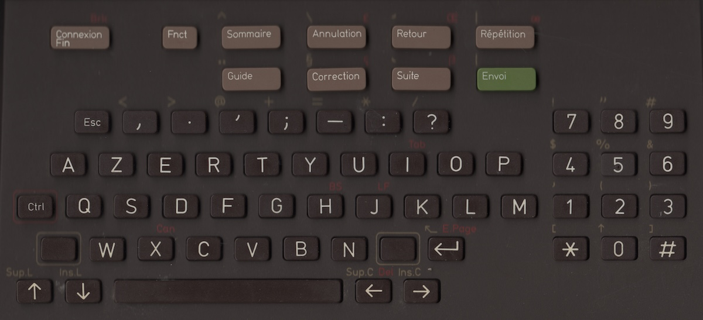

# Minitel/Keyboard

This folder contains multiple versions of a Minitel keyboard driver:

- [KeyboardPy](./KeyboardPy): User-land driver in Python, wired directly to the RPi's GPIO pins
- [KeyboardC](./KeyboardC): User-land driver in C++, similar to `KeyboardPy` but consumes less CPU
- [Keyboard32](./Keyboard32): ESP32-S3 firmware acting as a USB keyboard for the original keyboard, the recommended option
- [Stickers](./Stickers): Since the layout doesn't match the original Minitel layout, this folder contains instructions to print aesthetic stickers

All use almost identical layouts and behaviour, their own READMEs detail notable differences. All were tested on a RPi4 with 2GB RAM on Raspberry Pi OS Trixie.



### Keyboard layout

The keyboard layout is French only, here are the best settings to use with all drivers.

- On Raspberry Pi OS desktop (Wayland, labwc), update `~/.config/labwc/environment`:

    ```
    XKB_DEFAULT_MODEL=pc105
    XKB_DEFAULT_LAYOUT=fr
    XKB_DEFAULT_VARIANT=
    XKB_DEFAULT_OPTIONS=lv3:ralt_switch,compose:rctrl
    ```

- For the console and X11, update `/etc/default/keyboard`:

    ```
    XKBMODEL="pc105"
    XKBLAYOUT="fr"
    XKBVARIANT=""
    XKBOPTIONS="lv3:ralt_switch,compose:rctrl"
    
    BACKSPACE="guess"
    ```

Then log out and back in (labwc), or reboot (console and X11) to apply.

### Updated layout

A lot of keys on the Minitel don't match standard PC keys, while usual PC keys were missing. I took some liberty to adapt a bit the original Minitel keyboard layout in all drivers.

#### Top row

| Minitel label | Regular usage                   | Usage with Shift |
| :--- | :--- | :--- |
| Connexion     | Super (menu)                    |                  |
| Fnct          | Fn (to combine with other keys) |                  |
| Sommaire      | Home                            | ^                |
| Guide         | End                             | ¨                |
| Annulation    | Delete                          | \                |
| Correction    | Backspace                       | §                |
| Retour        | Back                            | ´ (accent aigu)  |
| Suite         | Forward                         | ` (accent grave) |
| Répétition    | Page Up                         | {                |
| Envoi         | Page Down                       | }                |

#### Modifiers

| Minitel label | Usage      |
| :--- | :--- |
| Left shift    | Left shift |
| Right shift   | Alt        |
| Control       | Control    |

Shift, Alt and Ctrl are sent immediately. Since the Minitel has specific combinations like `Shift + ,` to type `<`, a key with its own Shift symbol releases Shift while held and sends the AZERTY combination for that symbol instead, then Shift is restored.

Fnct sends nothing by itself, and a key without Fnct usage ignores it.

All original Ctrl usages printed in red (like `œ` for Ctrl + Répétition) have been removed, except Tab (I), BS (H), LF (J) and Can (X): terminals understand them as standard control codes.

#### Keypad

| Minitel label | Regular usage                                      | Usage with Shift |
| :--- | :--- | :--- |
| *             | Num Lock                                           | `[`              |
| #             | Compose (allows typing `Compose, o, e` to get `œ`) | `]`              |
| 0             | `0`                                                | `\|`             |

Digits need NumLock on. 1 to 9 type the symbol printed above them with Shift.

#### Regular

| Minitel label | Regular usage | Usage with Shift |
| :--- | :--- | :--- |
| Space         | Space         | Tab              |

All other keys type what is printed on them, and the upper symbol with Shift.

#### Function keys

| Fnct +    | Sends                                                                |
| :--- | :--- |
| 1 to 9    | F1 to F9                                                             |
| E         | €                                                                    |
| `-`       | `~`                                                                  |
| Retour    | Volume down                                                          |
| Suite     | Volume up                                                            |
| Connexion | Power: shuts the Pi down, or starts it once halted (Keyboard32 only) |

#### Missing keys

Compared to a standard keyboard, the following keys have not yet found their place:

- F10, F11 and F12
- Insert
- Caps Lock
- AltGr (its characters are available with Shift or Fnct)

### Limitations

The keyboard matrix has no diodes: holding 3 keys at the corners of a rectangle (e.g. W, B, D) makes the 4th one (G) look pressed. All drivers ignore new key presses in such a configuration. For instance Left Shift and Alt share a row: Ctrl + Shift + Alt can't be held together.

### Useful links

- [Labomedia](https://wiki.labomedia.org/index.php/Renaissance_d%27un_Minitel_avec_une_Raspberry_Pi)
- [GPIO Matrix Keyboard](https://github.com/nutki/rpi-gpio-matrix-keyboard/blob/master/gpio_keyboard.py)
- [Pinout](https://pinout.xyz)
- [UInput events](https://github.com/torvalds/linux/blob/master/include/uapi/linux/input-event-codes.h)
